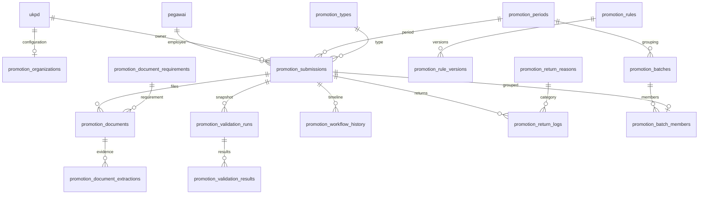
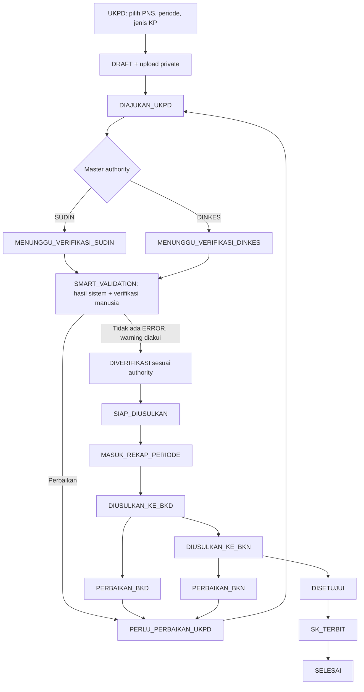

# Usulan Kenaikan Pangkat — audit dan desain

Audit 11 September 2026, sebelum implementasi, berdasarkan source snapshot dan schema-only dump PostgreSQL 27 Agustus 2026. Tidak menghubungi database produksi. Dokumen sumber: `petunjuk tambah usulan kenaikan pangkat.docx` di workspace induk.

## 1. Temuan existing

| Area | Temuan / reuse |
|---|---|
| Framework | Next.js 15.5.15 App Router, React 19, JavaScript ESM, Tailwind; scripts build/lint/node:test |
| Layout/routing | `src/app/(app)/layout.jsx` → AppShell; Sidebar/MobileSidebar mengambil `src/data/menu/sidebarMenu.js`; `/usulan/*` dilindungi middleware |
| Auth/session | `requireAuth`, same-origin guard, JWT jose di cookie `sdm_session`; tetap digunakan |
| RBAC | SUPER_ADMIN, ADMIN_WILAYAH, ADMIN_UKPD, CPNS, USER. Scope existing berdasarkan UKPD/wilayah. Tidak ada role DINAS tersendiri. Modul KP menambah capability terkonfigurasi di DB untuk role existing, tidak mengubah token/login |
| Database/ORM | PostgreSQL melalui `src/lib/db/postgres.js`, adapter backtick/placeholder `?`; Prisma schema hanya mendefinisikan core RBAC/audit, Prisma client tidak dipakai runtime. Adapter memotong Date menjadi tanggal: timestamp histori KP di-query sebagai text |
| Pegawai | PK `pegawai.id_pegawai`; UKPD `ukpd.id_ukpd`; pegawai mempunyai id_ukpd dan ukpd_id nullable serta nama_ukpd legacy. TMT pangkat `tmt_pangkat_terakhir`, pendidikan `jenjang_pendidikan`, jabatan Menpan/ORB, riwayat jabatan/pangkat terpisah. Jenjang jabatan perlu dipetakan, tidak disamakan dengan pendidikan |
| CPNS UI | `src/app/(app)/usulan/cpns-pns/page.jsx`, card surface, badge, filter, modal, loading, notice dan PdfDocumentPreview |
| CPNS API/data | `api/usulan/cpns-pns/{route,dokumen,download}`; `lib/usulan/cpnsPns.js`; `ensureCpnsPnsSchema.js`; tabel `usulan_cpns_pns`, dokumen/verifikasi JSON dalam text. Workflow CPNS berbeda, tidak diubah/dipakai untuk menyimpan KP |
| Upload | Dokumen CPNS private pada storage bertanda `.smart-hrm-usb-storage`, endpoint autentikasi. KP menggunakan root private tersendiri, marker volume yang sama, UUID, PDF MIME/signature/limit, pemindaian lokal sebelum penerimaan |
| Export | `buildWorkbookBuffer` existing digunakan untuk Excel; PDF menggunakan tampilan rekap print seperti pola browser export existing |
| Audit | `audit_logs`, `lib/audit-log/repository.js`. Writer existing best-effort dan dapat memicu notifikasi eksternal; KP insert ke tabel yang sama di transaksi agar mutation + audit atomik |
| Notifikasi | CPNS pending notice spesifik pada auth/me/AppShell; surat memakai WAHA spesifik surat, security alerts spesifik keamanan. Tidak ada event bus umum. KP menyajikan tugas/status/deadline pada halaman modul, tanpa engine atau pengiriman eksternal baru |

Tidak ada repository Git di snapshot. Source existing yang berubah hanya konfigurasi menu dan package scripts; file modul baru terpisah. Tidak menggunakan migrasi otomatis saat request.

## 2. Perubahan file yang direncanakan

* `prisma/migrations/202609110001_promotion/migration.sql`: schema tambahan + master awal aman, FK ke pegawai/UKPD existing.
* `scripts/migrate-promotion.mjs`: migrasi eksplisit, transaction, checksum, advisory lock.
* `src/lib/promotion/{policy,eligibility,workflow,reader,repository,service,api}.js`: engine deterministik, scope, reader lokal, transaksi, audit.
* `src/app/api/usulan/kenaikan-pangkat/**`: list/candidate/detail/create/action/document/configuration/batch/export.
* `src/app/(app)/usulan/kenaikan-pangkat/**`: dashboard, detail, form, konfigurasi, rekap; reuse PageHeader/DataTable/ActionDrawer/ConfirmDeleteModal/PdfDocumentPreview.
* `src/data/menu/sidebarMenu.js`: submenu desktop/mobile.
* `tests/promotion*.test.mjs`: rules, workflow, scope, parser, integrasi PostgreSQL terisolasi.

## 3. ERD

Master organisasi KP adalah extension 1:1 UKPD, bukan master UKPD duplikat. Routing berdasarkan organization_type/hospital_class/authority + wilayah tervalidasi. Nama UKPD hanya dipakai untuk mencocokkan identitas legacy bila ID kosong dan nama unik, tidak untuk menentukan jenis/routing. Metadata dokumen dan ekstraksi tidak mengubah master pegawai. Run menyimpan input, versi rule, hasil dan revision submission. Perubahan dokumen/master/rule membatalkan hasil lama sebagai dasar gate.

## 4. Workflow dan status machine

DITOLAK adalah terminal dengan catatan. Aksi server menentukan target; client tidak dapat mengirim status sembarang. Return melepas keanggotaan batch aktif. Setiap transisi dikunci `FOR UPDATE`, audit + timeline dalam transaksi. Batch hanya satu periode/authority/wilayah, gate diulang per pegawai.

## 5. Permission matrix

| Capability | ADMIN_UKPD | ADMIN_WILAYAH | SUPER_ADMIN / Dinas |
|---|---|---|---|
| Lihat | UKPD sendiri | wilayah sendiri + authority SUDIN | semua |
| Buat/edit/upload | UKPD sendiri, draft/perbaikan | tidak | tidak secara default |
| Pemeriksaan/verifikasi/return | lihat hasil | SUDIN wilayah sendiri | DINKES; koreksi SUDIN hanya capability khusus |
| Batch/rekap/export/status eksternal | tidak | SUDIN wilayah sendiri | DINKES; monitoring rekap semua |
| Master periode/rule/dokumen/organisasi/permission | tidak | tidak | SUPER_ADMIN |
| Portal pegawai | tidak ditambah | tidak ditambah | tidak ditambah |

Capability disimpan per role existing; role baru atau login baru tidak dibuat. Identitas scope tidak bisa dikirim frontend. CPNS dan USER ditolak. Status rule belum dikonfigurasi memblokir penetapan siap diusulkan (bukan warning yang bisa menghapus kebutuhan kebijakan).

## 6. Rule awal dan arsitektur validasi

PDFTextReader → bila halaman tanpa text layer OCRReader lokal → deterministic extraction (value, confidence, halaman, method, document ID) → manual review bila ambigu → PromotionEligibilityEngine → PASS/WARNING/ERROR. Tidak menggunakan LLM atau layanan AI publik.

KP-001 NIP; KP-002 TMT pangkat; KP-003 jabatan; KP-004 golongan; KP-005 transisi pangkat yang dikonfigurasi; KP-006 SKP; KP-007 kelengkapan; KP-008 identitas PAK; KP-009 konsistensi jenjang lintas dokumen; KP-010 periode PAK overlap; KP-011 SMART AK (awal + tambahan, total, minimum konfigurasi); KP-012 TMT jabatan; KP-013 rentang relevansi dokumen. Data kosong/hasil OCR ambigu tidak dianggap PASS. Prediksi periode hanya dibuat bila masa minimal mempunyai konfigurasi tervalidasi.

Rule version append-only, effective_start/end dan applicable_promotion_type/job_category; konfigurasi disnapshot pada run. Threshold, formula AK, periode SKP, rank transition dan masa dokumen tidak diasumsikan. Acknowledgement terkait run/result, actor dan alasan; setelah validasi baru harus diakui ulang.

## 7. Policy review dan sumber

TODO POLICY REVIEW: verifikasi substansi UU 20/2023, PP 11/2017 jo. PP 17/2020; PerBKN 2/2025; surat Deputi 13749/B-MP.01.01/SD/D/2025; SE BKD DKI 25/SE/2025 tanggal 22 September 2025; angka kredit JF sesuai jabatan; template nominatif BKD; klasifikasi organisasi/kelas RS/UPT dan kewenangan; deadline internal; mapping jenjang jabatan. Master awal berstatus REQUIRES_POLICY_CONFIGURATION sampai ditetapkan pejabat. Tidak mengaktifkan nilai hukum numerik berdasarkan contoh dalam brief.

Sumber resmi yang ditemukan saat audit:

* [PerBKN 4/2025, Pasal 2 dan 4](https://www.bkn.go.id/wp-content/uploads/2025/09/Peraturan-BKN-Nomor-4-Tahun-2025-tentang-Periodisasi-Kenaikan-Pangkat-PNS.pdf): tanggal 1 setiap bulan, berlaku 1 Oktober 2025. Deadline internal tetap konfigurasi.
* [PerBKN 2/2025](https://www.bkn.go.id/regulasi/peraturan-bkn-nomor-2-tahun-2025/): ditemukan, detail penerapan jenis usulan belum diaktifkan.
* [Surat Deputi BKN](https://www.bkn.go.id/storage/2025/09/Surat-Dinas_Penjelasan-Peraturan-BKN-Nomor-4-Tahun-2025-Tentang-Periodisasi-Kenaikan-Pangkat-PNS_13749_B-MP.01.01_SD_D_2025_koreksi-1.pdf).

SE BKD DKI yang disebut belum berhasil ditemukan pada penelusuran domain resmi saat audit; perlu salinan resmi. Rekap awal harus diberi label internal sampai format disahkan.

## 8. Urutan implementasi / verifikasi

Audit → desain (dokumen ini) → migration → service/API → UI → rules → reader → rekap → pengujian/security. Pengujian memakai data sintetis dan database lokal terisolasi; bukan menjalankan migration di produksi. Uji wajib mencakup IDOR 403, role, organisasi tak dikenal, gate ERROR/kebijakan kosong/hasil stale, race mutation, scope batch, file, rule version, OCR confidence, AK, overlap, determinisme. Runbook dan hasil aktual dicatat setelah implementasi.
